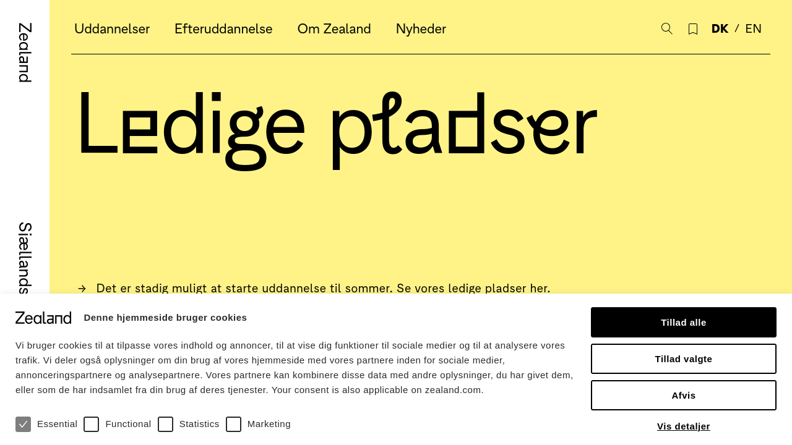

# Playwright Tests of zealand.dk

Automated end-to-end tests of my school's website, [zealand.dk](https://www.zealand.dk), written with Playwright in TypeScript. The tests run in three browser engines and run automatically on GitHub every time I push.

**Status:** Finished
**Context:** Exercise in Udvidet netværksteknologi, 3rd semester, IT-Technology at Zealand (EASJ), September 2026. Individual.

> Test names and comments are in Danish.



## The task

"You're a tester, and your job is to check whether zealand.dk works." The goal wasn't to test everything, but to pick a few things a real user depends on and check that they behave as expected.

## What the tests check

All tests are in [`e2e/zealand.spec.ts`](e2e/zealand.spec.ts):

| Test | What it checks |
| --- | --- |
| Forsiden kan åbnes | The front page loads and the logo is visible |
| Cookies kan afvises | The cookie banner can be rejected, and then disappears |
| Kan skifte til engelsk og tilbage til dansk | The language switch goes to zealand.com and back to zealand.dk |
| Overvågningspolitik peger på den rigtige PDF-fil | The surveillance-policy link points to the right PDF and opens in a new tab |
| Adgangskrav-sektion kan åbnes og lukkes | A collapsible section on a course page opens and closes |

The tests find elements the way a user sees them, by role and visible name (`getByRole('button', { name: 'Afvis' })`), rather than by CSS classes that might change. Each test then uses `expect()` to check the result.

## Browsers

`playwright.config.ts` runs every test in **Chromium**, **Firefox** and **WebKit** (Safari's engine), so 5 tests × 3 browsers = 15 runs.

## Runs automatically on GitHub

[`.github/workflows/playwright.yml`](.github/workflows/playwright.yml) is a GitHub Actions workflow. On every push, GitHub starts a fresh Linux machine, installs Playwright and the browsers, runs all the tests, and saves the HTML report. You can see the result under the **Actions** tab.

## Run it yourself

You need [Node.js](https://nodejs.org).

```
npm ci
npx playwright install
npm test
npm run report
```

`npm run report` opens an HTML report showing each test, step by step.

## Bonus: screenshot with Python

[`screenshot.py`](screenshot.py) uses Playwright's Python version to open zealand.dk in Firefox and save a screenshot, which is the image at the top of this page.

```
pip install playwright
playwright install firefox
python screenshot.py
```

## Note

These tests run against a real, live website that I don't control. If Zealand changes a button text or a link, the matching test will fail. That's a test doing its job, but it means a failing run doesn't always mean something is broken.
